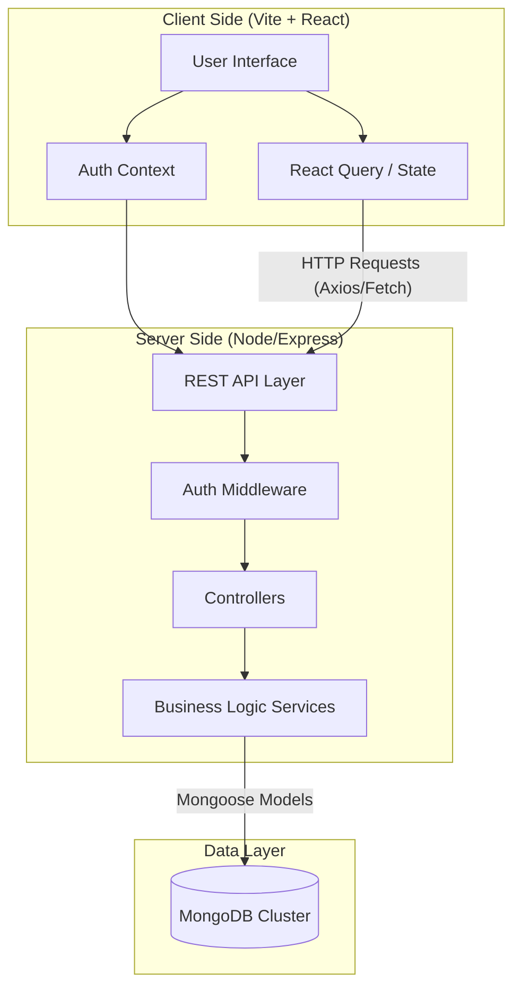
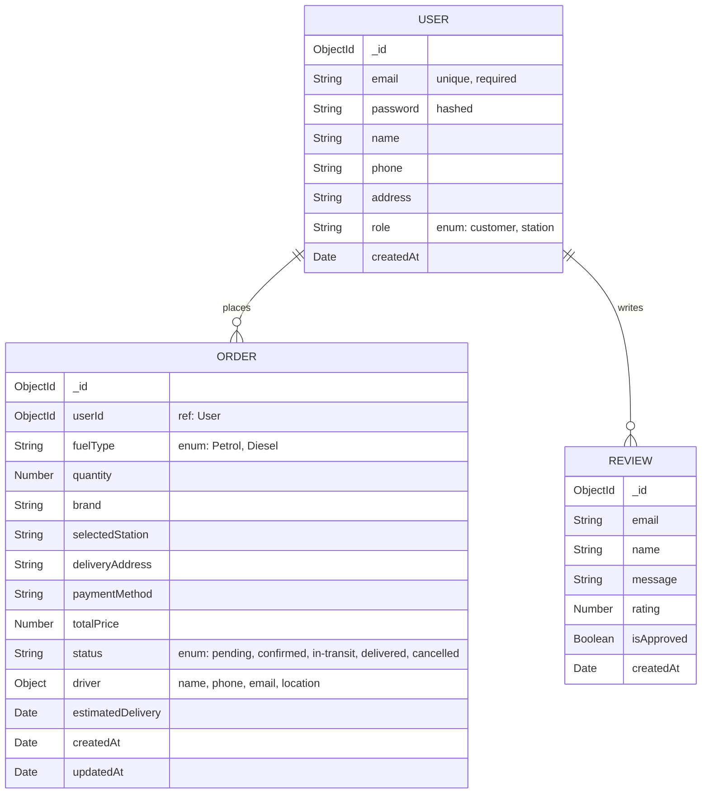
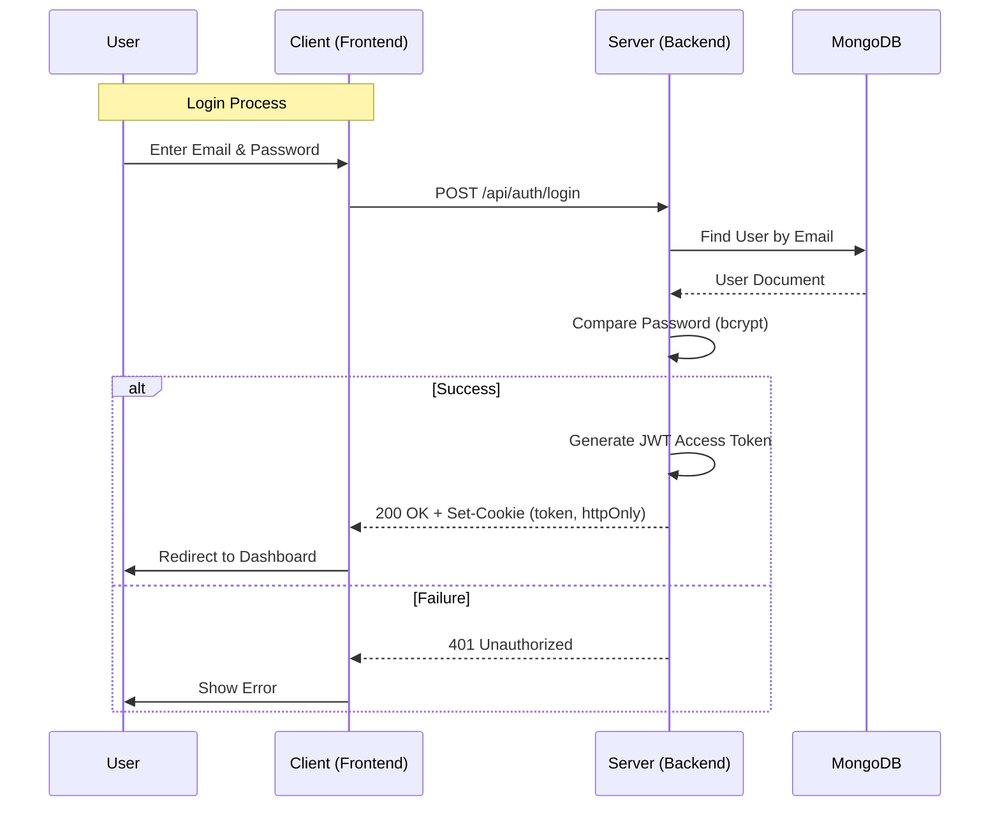
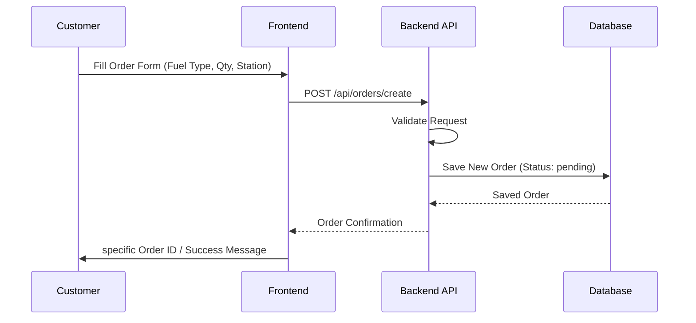

# FuelMate System Architecture

## 1. Project Overview
**FuelMate** is an on-demand fuel delivery management system built using the MERN stack (MongoDB, Express, React, Node.js). It facilitates fuel ordering for customers and order management for fuel stations.

### Technology Stack
- **Frontend**: React (Vite), TypeScript, Tailwind CSS, Shadcn/UI, React Query, React Router.
- **Backend**: Node.js, Express.js.
- **Database**: MongoDB (with Mongoose ODM).
- **Authentication**: JWT (JSON Web Tokens) in HTTP-only cookies.
- **External Services**: Mapbox GL (for maps/location).

## 2. High-Level Architecture
The system follows a classic Client-Server architecture.

## 3. Database Schema
The database consists of three primary collections: `Users`, `Orders`, and `Reviews`.

## 4. System Workflows

### 4.1. Authentication Flow
Authentication is handled via JWT stored in HTTP-only cookies.

### 4.2. Order Creation Flow
Customers place orders which are then received by the backend.

## 5. Directory Structure

### Root `c:\FuelMate`

#### Server (`/server`)
- **Controllers** (`/controllers`): Handle incoming HTTP requests and responses.
- **Services** (`/services`): Contain business logic (separation of concerns).
- **Models** (`/models`): Mongoose schema definitions (`User`, `Order`, `Review`).
- **Routes** (`/routes`): API route definitions mapping endpoints to controllers.
- **Middleware** (`/middleware`): Auth checks, error handling.

#### Client (`/client`)
- **Pages** (`/pages`): Top-level route components.
  - `Home`, `Features`, `About`, `Contact`: Public marketing pages.
  - `Index` (`/dashboard`, `/customer`): Customer Dashboard.
  - `StationDashboard` (`/station`): Fuel Station Dashboard.
  - `Auth`: Login/Signup page.
- **Components** (`/components`): Reusable UI elements (Shadcn/UI based).
- **Contexts** (`/contexts`): Global state (e.g., `AuthContext`).
- **Hooks** (`/hooks`): Custom React hooks.
- **App.tsx**: Main application component with Routing configuration.

## 6. API Endpoints Overview
Based on the route files analysis:

### Auth Routes (`/api/auth`)
- `POST /register` - Register a new user
- `POST /login` - Login and receive JWT
- `POST /logout` - Logout (clear cookies)
- `POST /refresh-token` - Refresh access token
- `GET /profile` - Get current user profile (Protected)

### Order Routes (`/api/orders`)
- `GET /` - Get active orders for the authenticated user
- `POST /` - Create a new order
- `GET /history` - Get order history
- `GET /:orderId` - Get specific order details
- `PATCH /:orderId/status` - Update order status (used by Station/Driver)

### Review Routes (`/api/reviews`)
- `GET /` - Get all approved reviews
- `POST /` - Submit a new review
